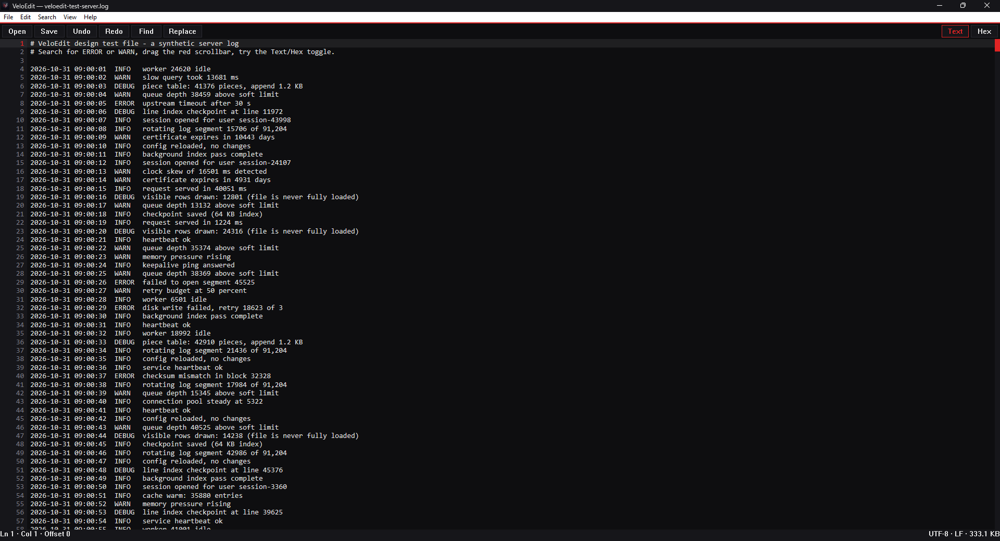
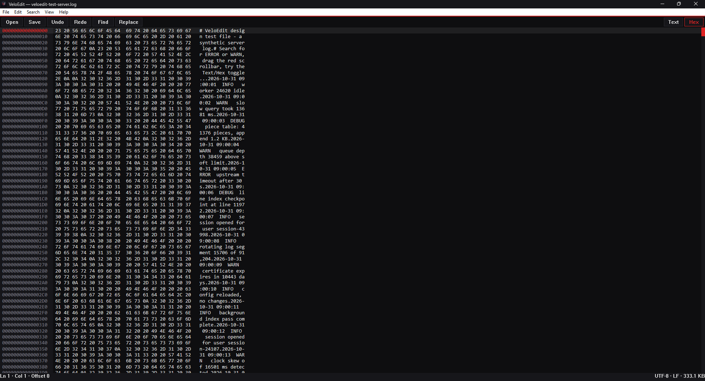

# VeloEdit

Zero-dependency, portable binary and large-file editor written in Rust.

## TL;DR

VeloEdit opens huge files — even over 100 GB — almost instantly and lets
you edit them without your computer slowing down. Think of a normal editor
like photocopying a whole book before you may fix one typo: it loads the
entire file into memory first. VeloEdit instead leaves the file where it is
on disk, looks at only the page you are viewing, and keeps your changes as
a small list of sticky notes saying "this part comes from the original,
this part is new". That is why it aims to open a 100 GB file in under a
tenth of a second while using less than 35 MB of memory. It is one portable
program file for Windows 11: no installer needed, no internet, no accounts,
nothing sent anywhere.

**Current status: 1.0.0, released 2026-10-31.** The editing core, the
command-line tools, the graphical editor window, and the packaging
(installer scripts and the release workflow) are built and shipped as
the v1.0.0 release. The core and tools are covered by the automated
test gate; the window is compile-verified and still needs its first run
on a real Windows 11 machine — see "Known limitations".

## Features

Working in this build:

- **Its own program icon** — the VeloEdit icon is embedded in the
  program file and used by the installer, shown in Explorer, on the
  taskbar, and in the window.
- **Piece-table editing core** — inserts and deletes rearrange a list of
  small pieces pointing at the original bytes and an append-only buffer;
  file data itself is never copied or shifted while editing.
- **Sparse line index** — line checkpoints every 64 KB make jumping to a
  line fast without scanning the whole file.
- **Hex arithmetic** — hex rows map to byte offsets with O(1) maths, and
  scrollbar positions use 64-bit ratios so they stay exact on files far
  past 2 billion bytes.
- **Undo and redo** — every edit is stored as a small reversible delta and
  can be undone or redone without touching the stored bytes.
- **Headless binary diff** — compare two files of any size from the
  command line in constant memory and get a JSON report.
- **Text encodings** — detection, decoding, and encoding for UTF-8,
  UTF-16 LE/BE, and ANSI (Windows-1252), with byte-order mark (BOM)
  detection. Malformed input is reported with its exact position, never
  silently repaired.
- **Search and replace (core)** — find streams over the piece table
  without loading the document into one buffer, and finds matches that
  span the seams between pieces. Replace and replace-all each count as
  a single undo step. From the command line, `--find` searches a file
  headlessly and reports match offsets as JSON.
- **Memory-mapped opening (Windows)** — files are opened as a
  read-only memory-mapped view, so even a 100+ GB file opens without
  loading it into memory; the operating system pages in only the bytes
  actually read.
- **Atomic save** — saving streams the document to a staging file next
  to the target, flushes it, then swaps it into place in one step, so
  a crash or failure mid-save can never corrupt the original. Saving
  starts a clean undo history. From the command line, `--save-copy`
  saves a copy of a file through the same pipeline.
- **Portable cleanup** — `--clean` removes only the `data/` folder next to
  the program file, and `--dry-run` shows what would happen first.
- **Scoped and masked search** — the find bar can limit find/replace to
  the current selection, and in hex mode it understands byte patterns
  with wildcards (`4A ?? FF 00 2B`, `?` = any nibble). The Edit menu can
  also sort the lines in a selection or remove duplicate lines.
- **File splitter** — split a huge file into numbered parts
  (`part001`, `part002`, …) from the command line or the window,
  streamed, without loading it.
- **Explorer menu item (opt-in)** — an "Open in VeloEdit" right-click
  entry for Explorer, added only when you ask for it
  (`--install-shell`, or File ▸ Explorer Menu Item) and removed by
  `--uninstall-shell` or `--clean`. It is the only registry entry the
  program writes, and it needs no administrator rights.

- **Graphical editor window (Windows)** — pure Win32 with
  Direct2D/DirectWrite rendering, per-monitor DPI scaling, and only the
  visible rows ever drawn. Text mode and hex mode (F6), find/replace
  bar (Ctrl+F / Ctrl+H), menus and a toolbar with tooltips for every
  button, drag-and-drop opening, a recent-files list, and a built-in
  guide (F1). Editing is byte-based, so binary files work regardless of
  encoding, and files open memory-mapped through the window too.
- **20 colour themes** — View ▸ Theme switches instantly between 20
  built-in themes (the black-and-red Obsidian from the specification is
  the default), and View ▸ Accent recolours the highlight colour on top
  of any theme: theme default, 11 presets, or a custom colour.
- **Crash recovery** — while you edit a document up to 16 MB, a snapshot
  is kept next to the program and offered back if the program closes
  unexpectedly. Larger documents rely on the atomic save alone.

## Requirements

- Windows 11, 64-bit (the released program).
- The core library and command-line tools also compile and pass their
  tests on Linux, which is how they are developed; the editor window
  itself is a Windows program.
- To build from source: Rust 1.80 or newer.

## Install

Releases are built by the release workflow
(`.github/workflows/release.yml`) on a Windows runner when a version
tag is published, and each release ships exactly these assets:

- `VeloEdit-v<version>-x64-Setup.exe` — the installer (NSIS script:
  `installer/VeloEdit.nsi`). Per-user install to
  `%LOCALAPPDATA%\Programs\VeloEdit` — no administrator prompt — with a
  Start Menu shortcut and an Add/Remove Programs entry; the uninstaller
  can also remove the `data/` folder if you tick that option.
- `VeloEdit-v<version>-x64-Setup.msi` — the enterprise installer (WiX v4
  script: `installer/Package.wxs`). Per-user package with major-upgrade
  support for managed deployments.
- `VeloEdit-v<version>-x64-Portable.zip` — unzip anywhere and run
  `VeloEdit.exe`; all settings live in the `data/` folder inside the same
  folder as the program (the zip includes a `data/README-data.txt`
  explaining it).
- `SHA256SUMS.txt` — SHA-256 checksums for verifying the downloads.

The installer script and the portable zip layout are proven locally;
the MSI is built for the first time by the release workflow itself, and
no asset has been published yet.

## How to use it

### In the window (Windows)

Run `VeloEdit.exe` with no arguments for a blank document, or pass a
file to open it:

```bash
VeloEdit.exe "C:\Logs\dump.bin" --line 10420
VeloEdit.exe "C:\Memory\core.dmp" --mode hex --read-only
```

`--line N` opens at line N; `--mode hex` starts in hex mode;
`--read-only` opens without allowing edits.

Once the window is open:

- **Open** with Ctrl+O, the Open button, File ▸ Recent, or by dropping
  a file onto the window. Big files open instantly: the file is
  memory-mapped, not loaded.
- **Type** to edit. Ctrl+Z undoes, Ctrl+Y redoes. Every change is one
  undo step.
- **Save** with Ctrl+S (File ▸ Save As for a new name). Saving is
  atomic and clears the undo history. If you close with unsaved
  changes, you are asked first.
- **Find** with Ctrl+F; **find and replace** with Ctrl+H. Enter finds
  the next match; the bar shows how many matches there are. Tick
  **In selection** on the bar to search and replace only inside the
  part you selected first; in hex mode, typing a byte pattern like
  `4A ?? FF 00 2B` (a `?` matches any nibble) searches by pattern.
- **Hex mode**: press F6 (or the Hex button) to see the raw bytes —
  16 per row, with the same bytes as characters on the right. Typing a
  hex digit (0–9, A–F) changes the byte under the caret.
- **Tidy a selection**: Edit ▸ Sort Lines in Selection orders the
  selected lines; Edit ▸ Remove Duplicate Lines in Selection drops
  repeated lines, keeping the first of each. Each is one undo step.
- **Split a file**: File ▸ Split File Copy… asks for a part size in
  megabytes, then writes a copy of the document as numbered parts in
  a `<name>-parts` folder and reports how many parts it made.
- **Themes**: View ▸ Theme picks from 20 built-in themes; View ▸
  Accent changes just the highlight colour. Moving through those
  menus previews each choice in the window — click to keep it, or
  close the menu to go back. Font size is in the same menu (or
  Ctrl+ '+' / Ctrl+ '-', or Ctrl+mouse wheel).
- **Column ruler**: View ▸ Column Ruler cycles a vertical guideline
  at column 80 or 120 (or off), for keeping lines to a set length.
- **Save selection**: File ▸ Save Selection to File… writes just the
  selected bytes to a file, streamed — a selection of any size can be
  exported.
- **Help**: press F1 for the built-in guide. It works offline.

Everything is stored in the `data/` folder next to the program:
settings (theme, accent, font size, window position, recent files) and,
while you edit a document up to 16 MB, a recovery snapshot that is
offered back after an unexpected close.

### From the command line (headless)

The headless tools run without opening a window:

1. Compare two files and save a JSON report:

   ```bash
   VeloEdit.exe --diff "A.bin" "B.bin" --output "report.json" --headless
   ```

   Exit code 0 means the files are identical; 1 means they differ; 2
   means an error (for example a file that cannot be opened). The
   report lists both sizes, the first differing byte offset, and how many
   bytes differ.

2. Compare and print the report instead of saving it:

   ```bash
   VeloEdit.exe --diff "A.bin" "B.bin" --headless --json
   ```

3. Search a file without opening it and get the match positions as JSON:

   ```bash
   VeloEdit.exe "notes.txt" --find "TODO" --headless
   ```

   This prints `{"count":2,"offsets":[0,31]}`-style output (byte
   offsets in the file) and exits with code 0 when at least one match
   is found, 1 when nothing matches. The encoding is detected from the file's first 64 KB; force
   it with `--encoding utf8`, `utf16le`, `utf16be`, or `ansi`.

4. Save a copy of a file through the atomic save pipeline:

   ```bash
   VeloEdit.exe "notes.txt" --save-copy "notes-backup.txt" --json
   ```

   This prints `{"bytes_written":N,"staging_removed":true}` and exits
   with code 0. The copy is written to a staging file first, flushed,
   then swapped into place; the file itself is never modified, and the
   destination must be a different path from the source.

5. Copy one byte range out of a file (carve a slice from a disk image,
   pull a header out of a binary):

   ```bash
   VeloEdit.exe extract "image.bin" --start 0x1000 --length 4096 --out "slice.bin"
   ```

   `--start` defaults to 0 and `--length` to the rest of the file;
   numbers are decimal or `0x`-hex. The range is clamped to the file,
   a start past the end of the file is an error (exit 2), and the
   bytes are streamed in 4 MB chunks, so the source can be huge.

6. Split a big file into numbered parts that are easier to move:

   ```bash
   VeloEdit.exe --split "huge-dump.bin" --part-size 4G --out-dir "parts"
   ```

   This writes `huge-dump.bin.part001`, `.part002`, … into the
   `parts` folder (the current folder when `--out-dir` is omitted);
   joining the parts in order restores the file exactly. Part sizes
   are plain byte counts or carry a `K`, `M`, or `G` suffix, and at
   most 10,000 parts are made.

7. Add the Explorer right-click menu item (and remove it again):

   ```bash
   VeloEdit.exe --install-shell
   VeloEdit.exe --uninstall-shell
   ```

   This adds "Open in VeloEdit" for all files under your user
   account only — no administrator prompt. `--clean` (next step)
   removes it too.

8. See everything the program can do from the command line:

   ```bash
   VeloEdit.exe --help
   VeloEdit.exe --version
   ```

9. Remove the portable data folder (with a safe preview first):

   ```bash
   VeloEdit.exe --clean --dry-run
   VeloEdit.exe --clean
   ```

The program is a GUI-subsystem executable, so opening the window
never flashes a console; started from a terminal, it borrows that
terminal for the command-line tools, so the same `VeloEdit.exe`
serves both.

## Command line reference

| Option | What it does |
| --- | --- |
| `<file>` | File to open |
| `--line <N>` | Open at line N |
| `--mode <hex\|text>` | Open in hex or text mode (default: text) |
| `--read-only` | Open without allowing edits |
| `--diff <A> <B>` | Compare two files byte by byte |
| `--find <TEXT>` | Find TEXT in the file; prints match count and byte offsets as JSON (exit 0 with matches, 1 with none) |
| `--encoding <NAME>` | Force the file encoding for `--find`: `utf8`, `utf16le`, `utf16be`, or `ansi` (default: detect) |
| `--save-copy <DEST>` | Save a copy of the file to DEST through the atomic save pipeline (destination must differ from the source) |
| `extract <file> --start <N> --length <M> --out <DEST>` | Copy one byte range of the file to DEST, streamed in 4 MB chunks; numbers are decimal or `0x`-hex, range clamped to the file |
| `--split <FILE> --part-size <SIZE> [--out-dir <DIR>]` | Split FILE into `<name>.part001`, `.part002`, … parts of SIZE bytes (a number, or `K`/`M`/`G`-suffixed like `500M`); streamed, at most 10,000 parts |
| `--install-shell`, `--uninstall-shell` | Add or remove the opt-in "Open in VeloEdit" Explorer menu item (current user only) |
| `--output <PATH>` | Write the JSON report (diff or save-copy) to a file |
| `--headless` | Run without opening a window |
| `--clean`, `--uninstall` | Remove the adjacent `data/` folder only |
| `--dry-run` | Show what an operation would do, without doing it |
| `--json` | Print results as JSON |
| `--silent` | Print nothing on success |
| `--verbose`, `--debug`, `--trace` | Print extra detail |
| `--help`, `--version` | Show help or the version |

Exit codes: 0 success (find: at least one match; diff: files
identical), 1 find found nothing / diff found differences, 2 usage or
I/O error — also used when the graphical editor is requested on a
build without window code (for example a non-Windows build).

## Configuration

All configuration and state live in the `data/` folder next to the
program file — never in `%APPDATA%` or the registry — so the program
stays fully portable. `data/settings.json` holds the theme, accent
colour, font size, window position, and recent-files list, plus the
undo limits — `undo_limit` (steps kept, default 1024, range
16–65536) and `undo_byte_budget_mb` (megabytes of stored changes,
default 256, range 1–4096) — and the column ruler, `ruler_column`
(0 = off, otherwise the character column of the guideline). It is
written by the program (editing it by hand works too — a damaged file
falls back to defaults and is kept as `settings.json.bad`). While you
edit, `data/recovery.bin` / `data/recovery.json` hold the crash
recovery snapshot described above.

## Building from source

```bash
cargo build --release
```

For a Windows target check from another host:

```bash
cargo check --target x86_64-pc-windows-gnu --all-targets
```

Windows release builds link the C/C++ runtime statically (`.cargo/config.toml`
sets `crt-static` for the MSVC target), so the program needs no
redistributables installed.

## Project structure

```text
Cargo.toml            Package definition; windows-sys is the only dependency
PROJECT_RULES.md      Binding project rules, budgets, and coverage floors
QUALITY.md            Quality scorecard with evidence
CHANGELOG.md          Change history
docs/SPEC.md          The complete engineering specification (governs design)
docs/PARITY.md        Operation registry: core API, CLI form, GUI form
docs/BENCHMARKS.md    SPEC §8 evidence: what is measured, what is not
installer/            Release packaging: VeloEdit.nsi (NSIS Setup exe),
                      Package.wxs (WiX v4 MSI)
scripts/              Run-Benchmarks.ps1 — the benchmark harness
                      (sparse fixtures, timed headless operations)
src/lib.rs            Library root and the operation (op_*) surface
src/editor.rs         Editor state machine the window is built on (caret,
                      selection, scroll, viewport rows, find state)
src/theme.rs          The 20 built-in themes and accent presets
src/settings.rs       Portable settings (hand-rolled JSON, data/ folder)
src/gui_win.rs        Win32 + Direct2D/DirectWrite window (Windows only)
src/piece_table.rs    Memory-mapped piece table engine
src/line_index.rs     Sparse 64 KB line checkpoint index
src/hexview.rs        Hex row and 64-bit scrollbar arithmetic
src/undo.rs           Undo/redo engine (inversion deltas)
src/encoding.rs       Encoding detection, decode, and encode (UTF-8, UTF-16, ANSI)
src/search.rs         Streaming find and single-undo replace over the piece table
src/mmap_win.rs       Windows read-only memory-mapped file backing (cfg(windows))
src/save.rs           Atomic save pipeline (staging file, flush, swap, remap)
src/diff.rs           Streaming binary diff and its JSON report
src/cli.rs            Hand-written argument parsing and headless commands
src/main.rs           Thin program entry point
```

## Tests

```bash
cargo fmt --all
cargo clippy --all-targets -- -D warnings
cargo test
```

The test suite covers insert/delete/coalescence across piece boundaries,
undo/redo restoring exact piece layouts, line checkpoints on synthetic
documents with known line layouts, scrollbar maths at sizes past 2^32, diff
results across chunk boundaries, command-line parsing, and the safety
guard on `--clean`. It also covers encoding detection (byte-order marks,
unmarked UTF-16, samples cut mid-character), lossless ANSI round trips of
all 256 byte values, strict UTF-16 error positions, searches whose needle
spans two or three pieces, replace-all undoing as one step to the
exact original layout, and the atomic save pipeline: edited-document
round trips, saving over an existing file, zero-length saves, chunked
streaming, and both failure paths (staging and swap) leaving the
original untouched with no staging file behind. The newest suites cover
the editor core (open → type → undo → redo → save round trips, caret
and selection behaviour, hex row formatting, find navigation and
read-only refusals, exact line positions after mid-document edits), the
20 themes (token validity and text contrast), and settings (round
trips, corruption handling, recent-file rules).

## Troubleshooting

- **Exit code 2 when opening a file** — the graphical editor exists only
  in the Windows build; on another platform the file argument is
  understood but there is no window code to open it with.
- **`--diff` reports exit code 2** — one of the two files could not be
  opened; the error message names the problem (for example a missing
  file). Check both paths. (Exit code 1 from `--diff` simply means the
  files differ.)
- **`--clean` refuses to remove the data folder** — it only ever removes a
  folder literally named `data` directly next to the program file, and
  refuses when that path is a file instead of a folder. Nothing is deleted
  in that case.
- **`--save-copy` refuses its destination** — the destination must be a
  different path from the source file. Saving a file over itself is the
  editor's Save command, not a copy; use a different destination name.

## Security and privacy

- Works 100% offline. There is no network code in the program.
- Zero telemetry: nothing about your files or usage is collected or sent.
- Your data stays in the file you are editing and the adjacent `data/`
  folder. Nothing is written to `%APPDATA%`, `%LOCALAPPDATA%`, or
  `%PROGRAMDATA%`. The one registry entry the program can write is
  the Explorer menu item, and only when you explicitly add it with
  `--install-shell` or File ▸ Explorer Menu Item — per-user, and
  removed by `--uninstall-shell` or `--clean`.

## Screenshots

Real captures from a run of the editor on Windows 11, showing a
6,007-line log file (333 KB) open in both modes:





Still to capture: the find bar with matches highlighted, a light
theme, and the installer.

## Known limitations

- The graphical editor has been run on a real Windows 11 machine:
  startup, painting, text and hex modes, the custom scrollbar, and
  resizing are verified from real captures (see Screenshots).
  Interactions still being exercised there include typing and saving
  from the window, the find bar, theme switching, and the recovery
  prompt; the installers have been built and hash-verified but not
  yet run through a full install on a real machine.
- Recovery snapshots cover documents up to 16 MB. Larger documents rely
  on the atomic save alone.
- Long lines are shown clipped at the window edge (no horizontal
  scrolling yet), and a line longer than 4096 characters is shown
  truncated with a marker. There is no word wrap.
- Direct2D/DirectWrite are called through hand-declared COM interfaces
  (windows-sys 0.61 ships no bindings for them and no other crate is
  allowed); the declarations follow the Windows SDK headers and are
  compile-verified like the rest of the window.
- One mapped-file risk, by design: files are opened with sharing modes
  that let other programs write them. If another program truncates a
  file while VeloEdit has it mapped, reading the cut-off part can fault
  instead of returning an error. Saving from VeloEdit itself is atomic
  and unaffected.
- Piece storage is a `Vec`; the weight-balanced B-tree from the
  specification is a planned optimisation, so lookups are linear in the
  number of pieces for now.
- The line-index scan is a plain chunked scan; the SIMD-accelerated scan
  from the specification is planned behind the same function.
- The undo history size (1024 edits in this build) is a placeholder:
  the final cap is to be confirmed. Saving a file also clears the undo
  history: a save is a clean starting point.
- Performance targets (cold start, memory caps, frame time) are
  specification targets and are unverified until measured on Windows.
  Host-side measurements of the core tools (200 MB diff/find/save
  timings from this development machine) are recorded in
  `docs/BENCHMARKS.md` — they are proxies, not the Windows numbers.
- The packaging has not produced a published release yet: the MSI is
  built for the first time by the release workflow on its Windows
  runner, and the installers have not been run on a real machine.

## License

MIT — see `LICENSE`.
